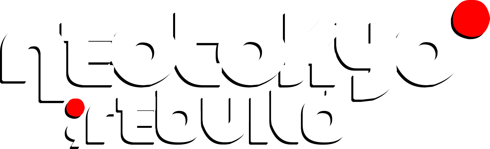
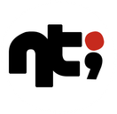

# Logos

The wiki uses four brand images. The **NT;RE mark** from Wireframe is the primary logo. It appears in the header of every page.

The other three come from the NEOTOKYO;REBUILD project's [Open Collective page](https://opencollective.com/neotokyorebuild). Each image is shown below on a dark and a light background.

## NT;RE mark

  

    
{{asset:mark}}

    
{{asset:mark}}

  

<table class="wikitable kv">
  <tbody>
    <tr><td>Role</td><td>Primary logo: the site header, beside a <code>WIKI</code> label</td></tr>
    <tr><td>File</td><td><a href="../../assets/nt-mark.svg"><code>docs/assets/nt-mark.svg</code></a>, inlined into the header by <code>overrides/partials/logo.html</code></td></tr>
    <tr><td>Source</td><td>Wireframe, <code>crates/viewer/web/src/app/header/glyphs.ts</code> at <code>3e7a535</code>. It is drawn from the terminal art <code>tools/logo.sh</code> prints, with each character a 1×2 cell.</td></tr>
    <tr><td>Colours</td><td>Letters in the current text colour, drop shadow in the same colour at 30%, dot <code>#d1482e</code></td></tr>
    <tr><td>Rights</td><td>© 2026 Dan Peavey. All rights reserved (Wireframe's licence).</td></tr>
  </tbody>
</table>

The letters take the colour of the text around them, so one file works in both themes. They're light on dark pages and dark on light ones. The dot stays the same red in both.

## NEOTOKYO;REBUILD wordmark

  

    

    

  

<table class="wikitable kv">
  <tbody>
    <tr><td>Role</td><td>Main page title</td></tr>
    <tr><td>File</td><td><a href="../../assets/wordmark.png"><code>docs/assets/wordmark.png</code></a>, 1500×458 PNG with transparency</td></tr>
    <tr><td>Source</td><td>Cover image of the Open Collective page: <code>images.opencollective.com/neotokyorebuild/3b68ff8/background.png</code></td></tr>
    <tr><td>Colours</td><td>White letters, hard black offset shadow, dots <code>#ff0000</code></td></tr>
    <tr><td>Rights</td><td>NEOTOKYO;REBUILD project</td></tr>
  </tbody>
</table>

## NT; badge

  

    

    

  

<table class="wikitable kv">
  <tbody>
    <tr><td>Role</td><td>Source of the favicon. It was the header logo until the Wireframe mark replaced it.</td></tr>
    <tr><td>File</td><td><a href="../../assets/nt-logo.png"><code>docs/assets/nt-logo.png</code></a>, 132×128 PNG</td></tr>
    <tr><td>Source</td><td>Avatar of the Open Collective page: <code>images.opencollective.com/neotokyorebuild/d857ad0/logo.png</code></td></tr>
    <tr><td>Colours</td><td>Black glyph on a 90%-opaque white disc, dot <code>#c62a1d</code></td></tr>
    <tr><td>Rights</td><td>NEOTOKYO;REBUILD project</td></tr>
  </tbody>
</table>

## Favicon

  

    

    

  

The browser-tab icon is [`docs/assets/favicon.png`](../assets/favicon.png), the NT; badge scaled to 64×64. Its disc keeps it readable on both light and dark tab bars.

## Open questions

- **Three reds.** The Wireframe mark uses `#d1482e`, the badge `#c62a1d` and the wordmark `#ff0000`. The site also uses `#ff0000` for its dots. Picking one red would make the wiki consistent. See [[colours-and-type|Colours & type]].
- **Favicon.** It still comes from the Open Collective badge. Switching to Wireframe's app icon would make the tab match the header.
