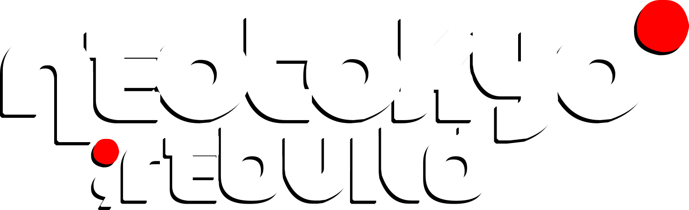

<h1 class="home-wordmark"></h1>

**NEOTOKYO Rebuild** is a tactical first-person shooter, rebuilt on the 2025 Source SDK. This wiki is its reference.

Every stat here comes from the game's source code, and links to the line it came from.

## Start here

-   **[[getting-started|Getting started]]**

    The rules every new player gets wrong: no headshot bonus, one life per round, ranks unlock guns.

-   **[[capture-the-ghost|Capture the Ghost]]**

    The core mode. Find the ghost, carry it home, or wipe the other team.

-   **[[classes|Classes]]**

    Recon, Assault and Support: health, speed, cloak and vision compared.

## Combat

-   **[[weapons|Weapons]]**

    Damage, rate of fire, penetration and shots to kill, side by side.

    SRM · ZR68C · MX · SRS · PZ252 …

-   **[[damage|Damage & penetration]]**

    The ×1.485 damage modifier, hit locations, how well bullets go through each material, and accuracy.

-   **[[loadouts|Loadouts & ranks]]**

    How much XP each gun needs, and how to earn it.

    Dog · Pvt · Cpl · Sgt · Lt

## Player mechanics

-   **[[thermoptic-camouflage|Thermoptic camo]]**

    13 seconds for Recon, 8 seconds for Assault, and what gives a cloaked player away.

-   **[[vision-modes|Vision modes]]**

    Night, motion and thermal: which ones see through cloak and smoke.

-   **[[movement|Movement]]**

    How fast you move with each weapon, plus leaning and fall damage.

-   **[[aux-power|AUX power]]**

    How fast each class spends and regains AUX, and why Recon sprints for free.

## Game modes

-   **[[ghost|The Ghost]]**

    Where it spawns, its beacon, the rules for whoever carries it, and what happens when it's dropped.

-   **[[team-deathmatch|Team Deathmatch]]**

    Respawning team fights, scored by kills.

-   **[[game-modes|All modes]]**

    How rounds and matches run, how a mode is chosen, and competitive settings.

!!! warning "Prototype"
    This is a design prototype built with MkDocs. Editing and images are placeholders. See [[about|About this wiki]] for what's in scope and how the data was gathered.
